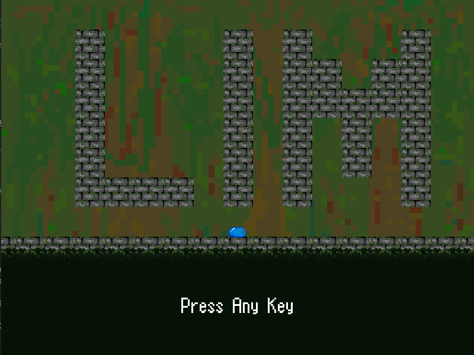

# LIM

C++とSDL2を使用して制作した2Dアクションゲームです。

## 概要

昔、C++の練習として制作したゲームです。

スライムを操作し、壁や天井に張り付きながら罠を避け、ゴールを目指します。

## スクリーンショット

## ダウンロード
https://www.freem.ne.jp/win/game/33502

## 操作方法

| キー | 操作 |
|---|---|
| ← / → | 左右移動 |
| ↑ | ジャンプ |
| Z | 張り付きモードの切り替え |

## 開発環境

- 言語：C++
- ライブラリ：SDL2、SDL2_image、SDL2_ttf
- OS：Windows

## 使用素材・クレジット

### フォント

フォント：ベストテンFONT
フリーダウンロード：https://flopdesign.booth.pm/items/2747965

